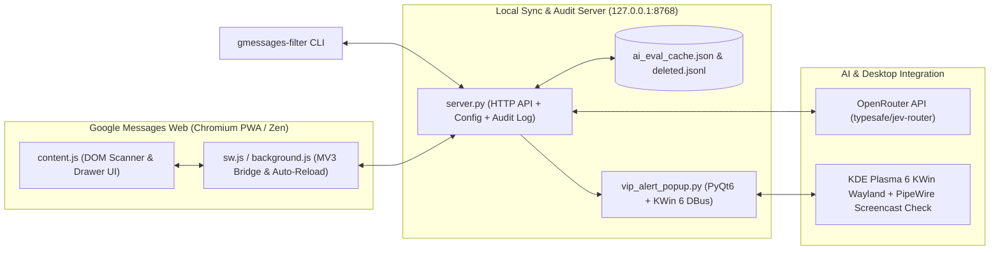

# Google Messages Web Auto-Filter (`gmessages-filter`)

[](https://github.com/russellmilliner/gmessages-filter/releases)
[](https://kde.org/plasma-desktop/)
[](https://messages.google.com/web)
[](https://openrouter.ai/)
[](LICENSE)

Automated message triage, spam blocking, age-based cleanup, **OpenRouter Jev (`typesafe/jev-router`) 1-call multi-category AI classification**, and **KDE Plasma 6 Wayland VIP center-desktop alerts** for [Google Messages Web](https://messages.google.com/web) running in a dedicated Chromium PWA or Zen/Firefox browser.

---

## Architecture



---

## Key Features

### 1. 1-Call OpenRouter Jev Multi-Category AI Filter (with `older_than` Age Thresholds)
Evaluates non-contact messages against **all** active AI categories in a single OpenRouter call (`typesafe/jev-router`), with persistent SHA-256 disk caching (`ai_eval_cache.json`) and per-category **`older_than`** age thresholds (`1d`, `24h`, `7d`, etc.):

| Category ID | Category | Age Threshold (`older_than`) | Action | Description |
| :--- | :--- | :--- | :--- | :--- |
| `cat-political` | **Political** | *(immediate)* | `block_spam` | Political campaigns, candidates, PACs, ballot amendments, voting prompts, fundraising |
| `cat-religion` | **Religion** | *(immediate)* | `block_spam` | Unsolicited religious outreach, ministry/church invitations, faith-based fundraising |
| `cat-real-estate` | **Real Estate** | *(immediate)* | `block_spam` | Unsolicited cash-for-houses offers, investor/wholesaler property inquiries |
| `cat-financial-offers` | **financial offers** | *(immediate)* | `block_spam` | Unsolicited loan approvals, credit/debt consolidation, tax relief pitches |
| `cat-login-codes` | **login codes** | **`1d` (`> 24h`)** | `delete` | One-time passcodes (OTP), 2FA/MFA verification codes, temporary login PINs |
| `cat-food-orders` | **food orders** | **`1d` (`> 24h`)** | `delete` | Restaurant, takeout, curbside check-in, or delivery order status notifications |

- **Deferred Age-Gated Deletion**: When a `login codes` or `food orders` message arrives (`ageDays < 1.0`), Jev classifies and caches it once, leaves it untouched in your inbox for the first 24 hours, and automatically deletes it once `ageDays >= 1.0` without making any additional OpenRouter calls.
- **MMS `"Picture"` Auto-Inspection**: Automatically opens recent (`<= 2d`) non-contact threads whose sidebar preview is `"Picture"` so campaign/spam text attached to an MMS image is inspected and filtered.

### 2. Static Pattern, Caller Number & Age Rules
Combine caller number (`-n`), substring/regex message text (`-m` / `-r`), and message age (`-o` / `--older-than`, e.g., `1d`, `24h`, `7d`, `2w`) with per-rule actions (`delete`, `block_spam`, or `archive`).

### 3. KDE Plasma 6 VIP Center-Desktop Alerts (Screen-Share Aware)
When a configured VIP contact messages you and either the Google Messages window is not visible on the current KDE virtual desktop or that contact's thread is not the active conversation:
- Launches a privacy-safe PyQt6 modal alert (`vip_alert_popup.py`, sender name + timestamp only, no message preview).
- Queries PipeWire (`pw-dump`) for active `kwin_wayland` screencast streams: places the alert on the primary display (`DP-1`) normally, or automatically shifts it to the secondary display (`DP-3`) via KWin 6 DBus scripting when screen sharing is active.

---

## CLI Usage (`gmessages-filter`)

```bash
# Show daemon status, active Jev AI categories, and static rules
gmessages-filter status

# Add or update OpenRouter Jev AI categories (with optional --older-than threshold)
gmessages-filter ai-add "login codes" --older-than 1d --delete
gmessages-filter ai-add "food orders" --older-than 1d --delete
gmessages-filter ai-add "Crypto" --block-spam
gmessages-filter ai-update cat-login-codes --older-than 24h --delete

# Test Jev AI evaluation on a sample message
gmessages-filter ai-test "Your Culver's order will be ready at 7:15 PM. Text HERE when you arrive."

# Add static rules (number, message text/regex, older_than)
gmessages-filter add -m "SunPass" --older-than 1d --archive
gmessages-filter add -n "898287" --archive

# Trigger an in-browser inbox scroll scan or deep thread scan
gmessages-filter scan --max 50
gmessages-filter scan --deep --max 40

# Manage VIP desktop alert contacts
gmessages-filter vip-list
gmessages-filter vip-add "Michelle Milliner"
gmessages-filter vip-test
```

---

## Installation & Release

```bash
# Install locally to ~/.local/share/gmessages-filter & ~/.local/bin/gmessages-filter
./scripts/install.sh

# Build release artifacts and publish to GitHub Releases via /home/millinr/Builds pipeline
/home/millinr/Builds/deploy-release.sh --project gmessages-filter --no-bump --yes --install-local
```
